  
   
  

  

  <picture>
    <source media="(prefers-color-scheme: dark)" srcset="https://raw.githubusercontent.com/Rtwotwo/Rtwotwo/output/github-contribution-grid-snake-dark.svg">
    <source media="(prefers-color-scheme: light)" srcset="https://raw.githubusercontent.com/Rtwotwo/Rtwotwo/output/github-contribution-grid-snake.svg">
    
  </picture>

<!-- BEGIN PROFILE DETAILS -->

# Xinyao Rao

Also known as **Yolo Redal / Rtwotwo**.

- I am a **master’s student at [Nanjing University](https://www.nju.edu.cn/)** (2026–2029, expected), affiliated with [CITE Lab](https://cite.nju.edu.cn/) and [NJU-3DV](https://nju-3dv.github.io/), advised by [Xun Cao](https://cite.nju.edu.cn/People/Faculty/20190621/i5054.html) and [Wei Li](https://is.nju.edu.cn/lw/main.htm).
- I completed my undergraduate studies at **[Northwestern Polytechnical University](https://www.nwpu.edu.cn/)** (2022–2026) and am currently interning at **[EABOT](https://www.eabot.tech/)**.
- My research interests are **World Models, Foundation Models, Vision-Language Models, Autonomous Driving, and Pre-/Mid-/Post-training**.
- My recent work includes [DriveSTA](https://arxiv.org/abs/2611.27515) on learning from scored trajectory alternatives, [DriveTTO](https://rtwotwo.github.io/DriveTTO/) on test-time trajectory optimization, and [Spark-H3](https://arxiv.org/abs/2611.24256) on efficient attention for video diffusion models.
- As of **November 5, 2026**, our **EABOT.AI** entry ranked **#1** on both official NAVSIM leaderboards: [NAVTEST v1](https://huggingface.co/spaces/AGC2024-P/e2e-driving-navtest) (**96.1906 PDMS**) and [NAVHARD v2](https://huggingface.co/spaces/AGC2025/e2e-driving-navhard) (**64.5806 EPDMS**).
- Find my publications on [Google Scholar](https://scholar.google.com/citations?user=zRt1tLAAAAAJ&hl=en), models and datasets on [Hugging Face](https://huggingface.co/Rtwotwo), and personal updates on [Xiaohongshu / 小红书](https://xhslink.cn/o/3UayJjRbFI3).
- Visit my [academic homepage](https://rtwotwo.github.io/Rtwotwo/) or read my [Resume](assets/cv.pdf) for more about my work. For research discussions and collaboration, reach me at [744044292@qq.com](mailto:744044292@qq.com).

<!-- END PROFILE DETAILS -->

## Recent Reading

[Browse my reading list](READING.md) — technical blogs and selected articles, organized by topic.
